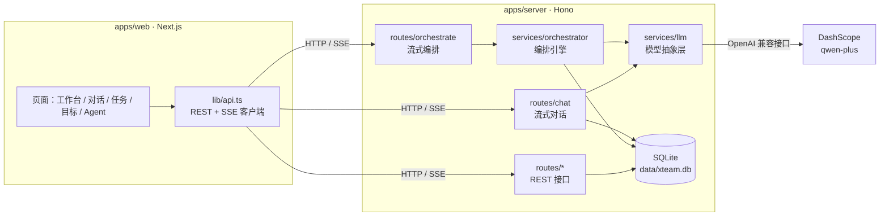
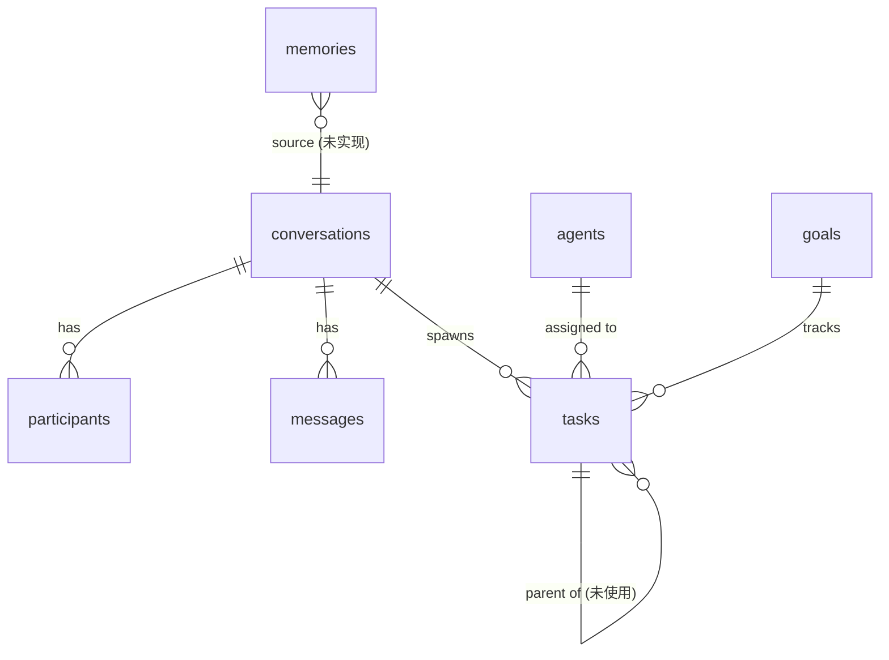
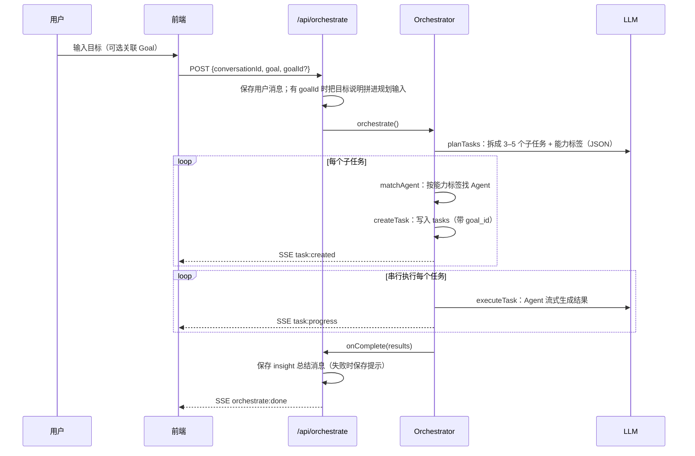

# XTeam 架构说明

本文描述 v0.1 的实际实现。规划中、尚未实现的部分会明确标注。

## 1. 系统总览



- 前后端分离，前端通过 `NEXT_PUBLIC_API_URL` 访问后端（默认端口 3100）
- 长耗时操作（对话、编排）使用 **SSE** 流式推送，前端边收边渲染
- 数据存在本地 SQLite（WAL 模式、外键开启），启动时自动建表并写入默认 Agent

## 2. 数据模型

`packages/core/src/types.ts` 是整个平台的领域模型蓝图；`apps/server/src/db/schema.ts` 是对应的表结构。



| 表 | 关键字段 | 说明 |
|---|---|---|
| `agents` | `capabilities`（JSON 数组）、`provider`、`model`、`status`、`tasks_completed` | 能力标签用于任务匹配 |
| `conversations` | `title`、`status`、`pinned_at` | |
| `participants` | `type`（human / agent）、`ref_id` | 对话参与者 |
| `messages` | `sender_type`（human / agent / system）、`content_type`（text / task_card / decision / insight）、`metadata` | `task_card` 存任务卡片，`insight` 存编排总结；`decision` 已预留 |
| `tasks` | `status`、`progress`、`result`、`assignee_id`、`goal_id`、`parent_task_id` | `parent_task_id` 已预留，目前任务是平铺的 |
| `goals` | `title`、`description`、`status` | 见下方「目标进度」 |
| `memories` | `source`、`tags`、`importance`、`expires_at` | 已建表，尚未读写 |

### 目标进度的计算方式

- 进度**不存库**：每次查询时按关联任务实时计算，`progress = 已完成 / 全部`
- 状态里只有「暂停」是手动设置的；「已达成」由「全部任务完成」推导
- 对话属于哪个目标，由它的任务的 `goal_id` 推导；关联、更换目标时，会更新这个对话下的所有任务
- 删除目标时，在同一个事务里先解除任务关联，再删目标

## 3. 编排流程

编排是平台的核心：把一句话目标变成一组由 Agent 执行的任务。实现在 `services/orchestrator.ts`。



要点：

1. **规划**：由规划模型输出 JSON 数组，每项包括标题、描述和能力标签，标签取自固定词表（如 `content_planning`、`data_analysis`、`writing`、`design`）
2. **匹配**：按能力标签依次查找不离线的 Agent，优先已完成任务多的；都没匹配上时退回到任意一个在线 Agent
3. **执行**：**串行**执行，避开 DashScope 的并发限制。进度按输出字数估算，上限 95%，完成时置为 100%
4. **容错**：SSE 写入失败（比如客户端断开）不会中断执行；结果都已落库，刷新页面后可以从数据库恢复
5. **前端呈现**：对话页把连续的 `task_card` 消息合并成一张「计划卡片」，`insight` 显示为可折叠的总结

## 4. API

所有接口都挂在 `/api` 下。

| 方法 | 路径 | 说明 |
|---|---|---|
| GET | `/agents` · `/agents/:id` | Agent 列表 / 详情 |
| POST · PATCH · DELETE | `/agents` · `/agents/:id` | 管理 Agent |
| GET | `/conversations` | 对话列表（含参与者数、任务数） |
| GET | `/conversations/:id` | 对话详情（含参与者、任务） |
| GET · POST | `/conversations/:id/messages` | 消息 |
| POST | `/conversations` | 新建对话 |
| PUT | `/conversations/:id/goal` | 把对话的全部任务关联到目标；`goalId: null` 表示取消关联 |
| GET | `/tasks?status=` · `/tasks/:id` | 任务 |
| POST · PATCH | `/tasks` · `/tasks/:id` | 管理任务 |
| GET | `/goals` · `/goals/:id` | 目标（含实时进度；详情含任务） |
| POST · PATCH · DELETE | `/goals` · `/goals/:id` | 管理目标；PATCH 可改标题、说明、状态（active / paused） |
| POST | `/chat/:conversationId/send` | **SSE** 流式对话：`start` → `chunk`* → `done` |
| POST | `/orchestrate` | **SSE** 流式编排：`orchestrate:start` → `task:created`* → `task:progress`* → `orchestrate:done` |

## 5. 模型抽象层

`services/llm.ts` 对外统一提供 `chat(config, messages, callbacks)` 流式接口：

- `dashscope` / `openai-compat`：走 OpenAI 兼容的 `/chat/completions`
- `anthropic`：直连 Anthropic API
- 每个 Agent 有自己的 `provider` 和 `model`，可以不同 Agent 用不同模型

配置都来自环境变量（见 `apps/server/.env.example`）：

| 变量 | 说明 |
|---|---|
| `DASHSCOPE_API_KEY` | 必填，阿里云百炼密钥 |
| `DASHSCOPE_BASE_URL` | 可选，默认 `https://dashscope.aliyuncs.com/compatible-mode/v1` |
| `ANTHROPIC_API_KEY` | 可选 |

> 密钥只能放在 `apps/server/.env`（已加入 gitignore），不要写进代码。

## 6. 前端结构

```
apps/web/src/
  app/(dashboard)/
    page.tsx              工作台：发起编排、待处理事项
    conversation/page.tsx 对话：聊天 / 编排 / 计划卡片 / 目标关联
    tasks/page.tsx        任务看板：四栏、按目标筛选
    goals/page.tsx        目标：列表、进度、展开任务
    agents/page.tsx       Agent 列表
  components/
    xt/                   基础组件：头像、标签、输入框
    conversation/         消息、计划卡片
    goals/                目标选择器
    layout/sidebar.tsx    侧边导航
  lib/api.ts              API 客户端（REST + SSE 解析）
```

- 设计令牌定义在 `app/globals.css` 的 `@theme` 中，遵循飞书 UD 色板：品牌蓝 `#3370ff`，中性色 N900 / N600 / N500 / N300
- 设计稿在 `design/xteam.pen`（Pencil）
